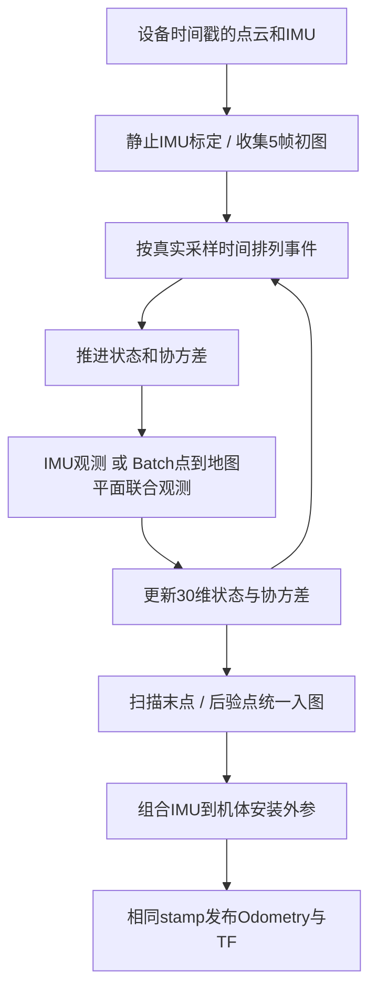

> 历史速记（2026-10-13前后），保留旧30维/0.1ms/冻结补偿描述供追溯，不是现行实现。2026-10-19已将当前24维/1ms/固定外参及完整补偿导数公式统一到[ly建模.md](odom_ws/src/ly_lio/docs/ly建模.md)，全部调试结果与失败方案见[验证.md](odom_ws/src/ly_lio/docs/验证.md)。下文“当前/默认”等均按旧记录理解。

当前 `ly_lio` 按《建模.md》实现 **Batch 点到历史地图平面的误差状态 EKF**。默认最长0.1ms一批（odom_ws/src/ly_lio/config/mid360.yaml中为0.0001秒），参数严格小于10ms；遇IMU事件提前分界，统一补偿到真实批末后联合更新一次。IMU采用输出观测模型，不融合轮速。相邻10ms平面方案仍停用。

最终位置和 TF 的来源是：滤波器持续维护 IMU 原点的位置和姿态，用运动模型预测，再由 IMU 及点到历史地图平面的观测修正，最后组合固定安装外参得到机体位姿。它不是对每个点计算一个互不相关的位姿再平均。

**状态和坐标系**

令 W=odom，I=IMU，L=雷达，B=baselink。恢复Point-LIO的30维误差排列为：

\[
\delta x=[\delta p,\delta\theta,\delta\theta_{IL},\delta t_{IL},\delta v,\delta\omega,\delta a,\delta g,\delta b_g,\delta b_a]^T.
\]

每项三维。p和R表示IMU在odom中的位置和朝向；a是IMU系比力，包含静止重力对应的测量，
不是已经去除重力的运动加速度；bg和ba是零偏。R_IL/t_IL描述激光→IMU变换。
`extrinsic_est_en=false`将外参6行/列协方差置零并固定状态；true启用在线联合估计。
IMU仍是6维输出观测。R和R_IL都采用右扰动并做SO(3)误差重置。
MID360 YAML保存芯片在激光系的位置c_L，内部换算`t_IL=-R_IL*c_L`，详见
[30维状态与外参](odom_ws/src/ly_lio/docs/验证.md)。

**预测和IMU观测**

相邻事件相差dt，使用：

\[
p_{k+1}=p_k+v_k\,dt,\quad
v_{k+1}=v_k+(R_k a_k+g_k)dt,\quad
R_{k+1}=R_k\operatorname{Exp}(\omega_kdt).
\]

静止时 `R*a+g≈0`，这就是重力补偿。原始IMU输入不提前扣重力。本项目驱动加速度单位g，
先乘 `|gravity|/acc_norm` 换为m/s²；接sentry驱动的SI数据时应设置相同的acc_norm和重力模长，
使比例为1，并相应调整饱和门限。

IMU是输出观测，残差为：

\[
z_{imu}=\begin{bmatrix}\omega_m-(\omega+b_g)\\a_m-(a+b_a)\end{bmatrix}.
\]

它修正状态中的真实角速度、比力和零偏，也会通过交叉协方差影响其他状态。达到配置量程95%的轴，其残差和雅可比一起屏蔽。
初始化从静止窗口估计重力方向、陀螺零偏和沿重力方向的加速度模长误差；单姿态不能完成全轴标定。

**一批激光点怎样修正位姿**

先传播P再传播x到批末e，F使用区间起点状态。对批中时刻t_j的点qL，
先变到IMU系，再按同一个批末先验补偿（dt_j=t_j−t_e）：

\[
q_I=\operatorname{Exp}(\omega_e dt_j)(R_{IL}q_L+t_{IL})+R_e^T v_e dt_j,\qquad q_W=R_eq_I+p_e.
\]

在已有历史地图中找5个邻近点并PCA拟合平面 `n^T*q+d=0`。共线、重合、非平面或明显错误关联会被拒绝。
预测点偏离平面的有符号距离是 `e=n^T*qW+d`，滤波使用观测减预测的残差 `z=-e`。
固定外参时非零雅可比包括：

\[
H_p=n^T,\qquad H_\theta=(q_I\times R^Tn)^T.
\]

在线外参时再增加6列。令`D=Exp(omega_e*dt_j)`、`C=R^T*n`，冻结本批D与速度补偿：

\[
H_{\theta_{IL}}=(q_L\times R_{IL}^T D^T C)^T,\qquad H_{t_{IL}}=(D^T C)^T.
\]

沿同一个平面滑动没有距离变化，因此单一平面无法约束所有自由度。场景中不同法向的平面一起提供约束，
IMU维持时间传播；不能把沿平面没有观测的信息凭空补出来。

**更新的具体计算**

每次观测前先将协方差推进到相同时刻：

\[
P^-=FPF^T+Q\,dt_{ref}\,dt,\quad dt_{ref}=0.005s.
\]

这里Q仅含omega/a/bg/ba四组，移除直接速度噪声。沿用200Hz参考周期配置，
乘参考周期转换方差率，避免把同一时间拆成更多批次后累计噪声变小。
同批点的标量残差按行堆叠为z/H，独立点的噪声构成对角阵R_L：

\[
S=HP^-H^T+R_L,\qquad K=P^-H^TS^{-1},\qquad\delta x=Kz.
\]

位置直接加delta_p，姿态右乘Exp(delta_theta)，其他状态也按相应误差修正。
位置/姿态观测能修正速度和零偏，是因为P保存它们之间的相关性。
协方差更新后用相同SO(3)误差坐标重置雅可比处理姿态块，维持名义状态与误差定义一致。
代码通过固定外参6维/在线外参12维信息累加和先验白化实现与堆叠方程等价的求解，避免构造大维度S。
同一批只注入一次；本批后验成为下一事件先验，始终只有一个当前状态。

每批用后验R/p将已补偿点变世界；在线模式先加上`D*((E_post-E_prior)*q_L+t_post-t_prior)`，
仍冻结本批运动补偿。暂存到整扫描结束才统一入图，避免当前扫描给自身提供伪历史约束。
地图每格保留多个有最小间距的真实点，保证局部平面有足够几何支持。

**如何得到baselink位置和TF**

安装文件给出雷达→机体 `T_BL`，内部标定给出雷达→IMU `T_IL`：

\[
T_{BI}=T_{BL}T_{IL}^{-1},\qquad
\boxed{T_{WB}=T_{WI}T_{BI}^{-1}}.
\]

设 `r_IB=-R_BI^T*t_BI` 为机体原点在IMU坐标系中的位置：

\[
p_{WB}=p_{WI}+R_{WI}r_{IB},\quad
R_{WB}=R_{WI}R_{BI}^T.
\]

这两个量写入 `/ly_lio/odometry`，也作为 `/tf` 的 odom→baselink 平移和旋转。
速度还需杆臂项 `v_WB=v_WI+R_WI*(omega_I×r_IB)`；位姿及速度协方差同样通过完整雅可比变换。
默认固定T_BL安装在线重算T_BI，输出雅可比包含外参误差与交叉项；显式固定T_BI则无需该依赖。
`/tf_static` 只表达固定 baselink→livox_frame 安装关系；baselink是随刚体运动的坐标系，不会因程序启动固定在世界中。

odom参考由启动初始化建立，不是GPS绝对坐标，也没有回环消除长期漂移。
当前安装标定指向云台中心；若云台相对底盘运动，不能仅凭固定外参得到底盘姿态。

**时间和频率**

两传感器使用设备PTP时间转UTC，各自采样时刻可以不同。点时间是点云header加逐点偏移，IMU用自身header。
程序按它们的真实先后时刻更新，无需让两个header相等，也不使用收包时间或now()替代采样时间。

默认每帧最后有效点发布一次约10Hz Odom/TF/注册点云，但扫描内部进行了多个Batch联合观测。
`publish_odometry_per_batch=true` 可按实际批末发布位姿，仍会随整帧输入成批发出。
这与sentry的独立IMU预测器按100Hz发布不同；高发布频率本身不证明精度更好。

本轮改动、与文档的工程差异及零漂验证见 [文档模型改进与零漂验证](odom_ws/src/ly_lio/docs/验证.md)。
